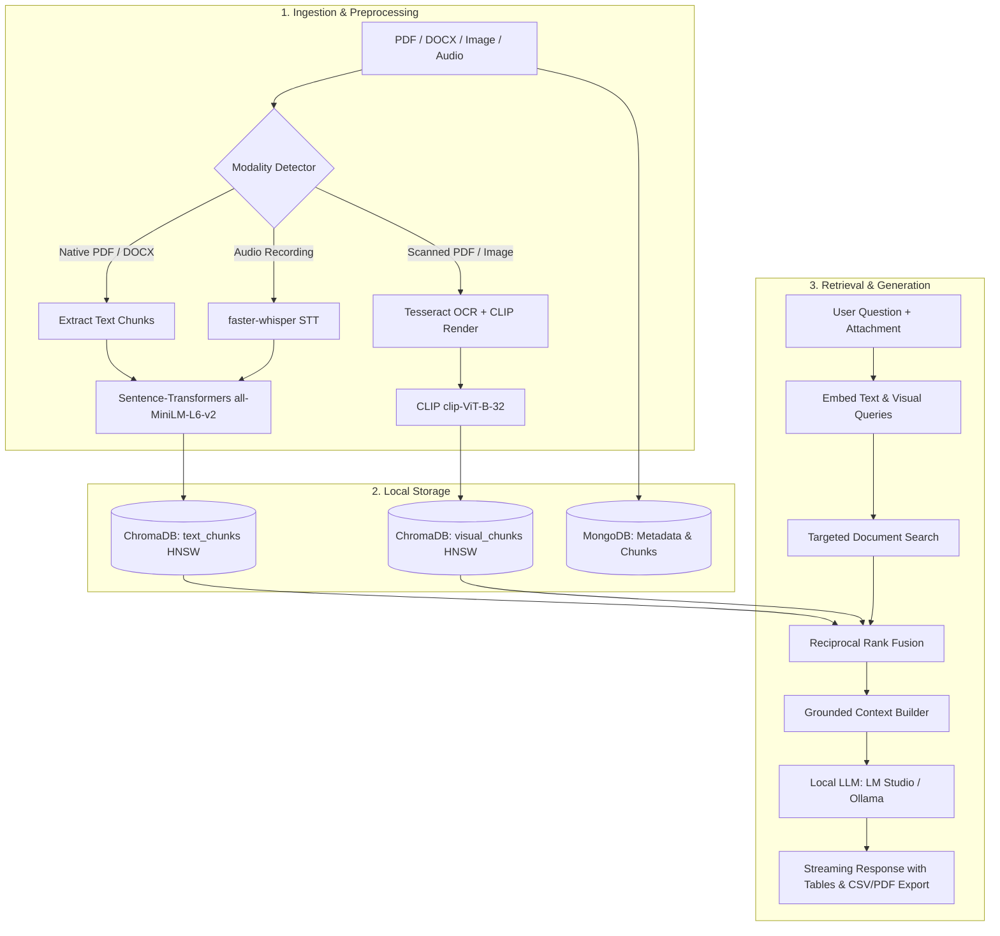

# ⚡ NEXUS-RAG — Offline Multimodal Semantic AI System

> **100% Offline Multimodal Retrieval-Augmented Generation (RAG) Platform**  
> Ingest PDFs, Word documents, images, and audio recordings. Retrieve answers via dual-modality semantic search (MiniLM + CLIP) with Reciprocal Rank Fusion (RRF), powered by locally hosted LLMs (**LM Studio** / **Ollama**). Zero cloud dependencies, zero data leakage, and complete privacy.

---

## 📑 Table of Contents
1. [Overview](#-overview)
2. [What Technologies & Libraries Are Used](#-what-technologies--libraries-are-used)
3. [System Architecture](#-system-architecture)
4. [Prerequisites](#-prerequisites)
5. [Step-by-Step Setup Guide](#-step-by-step-setup-guide)
   - [Step 1: Start Local MongoDB](#step-1-start-local-mongodb)
   - [Step 2: Setup Local LLM (LM Studio or Ollama)](#step-2-setup-local-llm-lm-studio-or-ollama)
   - [Step 3: Setup & Run Backend (FastAPI)](#step-3-setup--run-backend-fastapi)
   - [Step 4: Setup & Run Frontend (React)](#step-4-setup--run-frontend-react)
6. [Default Login Credentials](#-default-login-credentials)
7. [Key Features & Capabilities](#-key-features--capabilities)
8. [Docker Compose Deployment (Optional)](#-docker-compose-deployment-optional)
9. [Troubleshooting & FAQ](#-troubleshooting--faq)

---

## 🌟 Overview

**NEXUS-RAG** is a full-stack, multimodal RAG application designed to run entirely on local consumer hardware (such as Apple Silicon Mac M1/M2/M3, Linux, or Windows with 8GB+ RAM).

Unlike traditional text-only RAG pipelines, NEXUS-RAG implements a **dual-modality embedding architecture**:
- **Text Path**: Evaluates semantic text meaning using sentence transformers.
- **Visual Path**: Evaluates visual document layout, charts, scanned pages, and images using OpenAI CLIP.
- **Fusion**: Combines both semantic spaces using **Reciprocal Rank Fusion (RRF)** to deliver grounded, cited answers.
- **Interactive UI**: ChatGPT & Antigravity-inspired interface with dark glassmorphism, structured Markdown tables, and one-click **CSV & PDF export**.

---

## 🛠️ What Technologies & Libraries Are Used

This project brings together modern open-source AI, vector search, and web frameworks:

### 1. Frontend (Web Application)
* **Framework**: React 18 (SPA)
* **Styling**: Tailwind CSS with custom glassmorphism design tokens (dark neon aesthetic, sleek translucent cards, glowing focus borders)
* **Animations**: Framer Motion for responsive message streaming and UI transitions
* **Icons**: Lucide React
* **Markdown & Tables**: `react-markdown` + `remark-gfm` with custom interactive table components (includes one-click **Copy to Excel/TSV** and **Download CSV**)
* **HTTP & Notifications**: Axios, Sonner / Toast notifications

### 2. Backend (API & Server)
* **Framework**: FastAPI (high-performance asynchronous Python REST framework)
* **ASGI Server**: Uvicorn
* **Data Validation**: Pydantic v2 schemas
* **Authentication & Security**: JWT (JSON Web Tokens) with Python-Jose, Passlib, and BCrypt password hashing
* **Database Driver**: Motor (asynchronous MongoDB driver for asyncio)

### 3. Multimodal AI & Embedding Models
* **Text Embeddings**: `sentence-transformers/all-MiniLM-L6-v2` (384-dimensional dense vectors, CPU & Apple Silicon MPS optimized)
* **Visual Embeddings**: OpenAI CLIP `clip-ViT-B-32` (512-dimensional multimodal vision-language embeddings)
* **Local LLM Runners**:
  * **LM Studio** (OpenAI-compatible local server at `http://localhost:1234/v1`) — recommended model: `qwen2.5-vl-3b` (Vision-Language) or `qwen2.5-7b`
  * **Ollama** (`http://localhost:11434`) — e.g., `qwen2.5:3b`, `mistral:7b`, `llama3.2`
  * *Cloud Fallback* (optional): Emergent Universal Key for Claude / OpenAI if local server is unreachable

### 4. Vector Database & Ranking Engine
* **Vector Store**: **ChromaDB** with persistent on-disk HNSW index (`cosine` similarity space)
* **Rank Fusion**: **Reciprocal Rank Fusion (RRF)** algorithm dynamically blending text and visual vector hit lists

### 5. Document Ingestion & Parsers
* **PDF Processing**: **PyMuPDF (`fitz`)** for rapid page-by-page text and raster rendering
* **OCR Fallback**: **Tesseract OCR (`pytesseract`)** for automated text extraction on scanned PDFs, receipts, and image-based documents
* **Word Documents**: `python-docx`
* **Images**: Pillow (PIL) + PyTesseract OCR + CLIP embedding
* **Audio Transcription**: `faster-whisper` (local CTranslate2 engine for offline speech-to-text)

### 6. Local Storage & File Generation
* **MongoDB**: Stores users, authentication, conversation histories, and document metadata offline
* **Local File Exporters**: ReportLab (PDF generation), `python-docx` (DOCX generation), and `openpyxl` (Excel XLSX generation)

---

## 🏛️ System Architecture



---

## 📦 Prerequisites

Before getting started, make sure you have the following installed on your machine:

1. **Python 3.10+** (Python 3.10, 3.11, or 3.13)
2. **Node.js 18+** & `npm`
3. **MongoDB** (Local Community Edition)
4. **Tesseract OCR** (for extracting text from scanned documents/images)
   * **macOS**: `brew install tesseract`
   * **Ubuntu / Debian**: `sudo apt-get install tesseract-ocr`
   * **Windows**: Download installer from UB-Mannheim Tesseract GitHub
5. **LM Studio** *(Recommended)* or **Ollama** (for local offline LLM inference)

---

## 🚀 Step-by-Step Setup Guide

### Step 1: Start Local MongoDB

NEXUS-RAG requires a running MongoDB instance on `localhost:27017`:

* **macOS (Homebrew)**:
  ```bash
  brew services start mongodb-community
  ```
* **Linux (systemd)**:
  ```bash
  sudo systemctl start mongod
  ```
* **Docker (quickest alternative)**:
  ```bash
  docker run -d --name nexus-mongo -p 27017:27017 mongo:latest
  ```

---

### Step 2: Setup Local LLM (LM Studio or Ollama)

#### Option A: LM Studio (Recommended for Vision & Speed)
1. Download and install [LM Studio](https://lmstudio.ai/).
2. In LM Studio, search for and download:
   * **`qwen2.5-vl-3b`** (or `qwen2.5-7b-instruct` / `qwen2.5-3b-instruct`).
3. Click the **Local Server** tab (icon with `<->` on the left sidebar).
4. Select the downloaded model and click **Start Server**.
5. Ensure the server is listening on: `http://localhost:1234` (OpenAI-compatible `/v1`).

#### Option B: Ollama
1. Install [Ollama](https://ollama.com/).
2. Pull a model in terminal:
   ```bash
   ollama run qwen2.5:3b
   # or
   ollama run mistral:7b
   ```
3. Ollama runs automatically on `http://localhost:11434`.

---

### Step 3: Setup & Run Backend (FastAPI)

1. Open a new terminal and navigate to the backend directory:
   ```bash
   cd backend
   ```

2. Create and activate a Python virtual environment:
   ```bash
   # macOS / Linux
   python3 -m venv .venv
   source .venv/bin/activate

   # Windows
   python -m venv .venv
   .venv\Scripts\activate
   ```

3. Install required Python packages:
   ```bash
   pip install --upgrade pip
   pip install -r requirements.txt
   ```

4. Configure Environment Variables (`backend/.env`):
   Verify or create `backend/.env` with the following configuration:
   ```env
   LOCAL_LLM_PROVIDER=lm_studio
   LM_STUDIO_HOST=http://localhost:1234/v1
   LM_STUDIO_MODEL=qwen2.5-vl-3b
   LM_STUDIO_VISION_MODEL=qwen2.5-vl-3b
   MONGO_URL=mongodb://localhost:27017
   DB_NAME=nexus_rag
   JWT_SECRET=nexus-rag-offline-super-secret-key-2026
   ADMIN_EMAIL=admin@nexusrag.ai
   ADMIN_PASSWORD=admin123
   FRONTEND_URL=http://localhost:3000
   ```
   *(Note: If using Ollama, set `LOCAL_LLM_PROVIDER=ollama` and `OLLAMA_HOST=http://localhost:11434`)*

5. Start the FastAPI backend server:
   ```bash
   uvicorn server:app --host 0.0.0.0 --port 8001
   ```
   * The backend API will be live at: **`http://localhost:8001`**
   * Interactive Swagger documentation is available at: **`http://localhost:8001/docs`**

---

### Step 4: Setup & Run Frontend (React)

1. Open a second terminal and navigate to the frontend directory:
   ```bash
   cd frontend
   ```

2. Install Node dependencies:
   ```bash
   npm install
   ```

3. Verify Frontend Environment (`frontend/.env`):
   Ensure `frontend/.env` points to the backend port (`8001`):
   ```env
   REACT_APP_BACKEND_URL=http://localhost:8001
   PORT=3000
   ```

4. Start the frontend development server:
   ```bash
   npm start
   ```
   * The web application will launch in your browser at: **`http://localhost:3000`**

---

## 🔑 Default Login Credentials

Upon starting, the backend automatically seeds an initial administrator account:

| Role | Email | Password |
| --- | --- | --- |
| **Admin** | `admin@nexusrag.ai` | `admin123` |

> 💡 *You can also create a new personal account anytime by clicking **"Register"** on the login page.*

---

## 💎 Key Features & Capabilities

### 1. Attachment Shelf & Drag-and-Drop
Attach any PDF, DOCX, image, or audio recording using the attachment paperclip or by dragging files directly into the prompt bar (similar to ChatGPT and Antigravity).

### 2. Structured Markdown Tables
When asked to extract entities, financial metrics, comparisons, or summaries from documents, the AI formats the extracted data into clean, modern tables with alternating rows and glowing headers.

### 3. One-Click CSV & PDF Export
* **Download CSV**: Click the direct **"Download CSV"** button on top of any table or in the message header/footer to export your data into a UTF-8 BOM CSV file (compatible with Excel, Apple Numbers, and Google Sheets).
* **Copy Table (TSV)**: Copy tables directly to your clipboard for instant pasting into spreadsheet rows.
* **Executive PDF Export**: Print or save responses formatted as documents.

### 4. Direct Document Targeting & Noise Isolation
When an attachment is active or referenced by name (e.g. `Hariom_Resume.pdf`), the search pipeline isolates that document's text chunks, eliminating false matches from other unrelated documents.

### 5. Explainability & Fusion Dashboard
Visit the **Dashboard** tab in the navigation bar to inspect side-by-side rankings:
* Text-path matches (Sentence Transformers)
* Visual-path matches (CLIP)
* RRF fusion score distribution
* 2D embedding space projection and latency breakdown

---

## 🐳 Docker Compose Deployment (Optional)

To run the entire stack inside Docker containers:

1. Ensure Docker Desktop is running.
2. Build services sequentially to avoid memory pressure:
   ```bash
   docker compose build backend
   docker compose build frontend
   docker compose up
   ```
3. Access the services:
   * Frontend: `http://localhost:8080` (or `http://localhost:3000`)
   * Backend API: `http://localhost:8000`

---

## ❓ Troubleshooting & FAQ

#### 1. Backend shows CORS error when logging in
* Ensure your backend `.env` has `FRONTEND_URL=http://localhost:3000` (or matching your frontend port).
* Make sure `frontend/.env` points to the correct backend port (`REACT_APP_BACKEND_URL=http://localhost:8001`).

#### 2. Model says "I don't have information on this file"
* Verify your file reached the **Indexed** status in the **Knowledge Base** tab.
* In the new update, attached files are automatically prioritized and retrieved directly into context.

#### 3. LM Studio connection error (`[LM Studio Error]` or connection refused)
* Check that LM Studio's Local Server is running on port `1234`.
* Confirm the loaded model in LM Studio matches `LM_STUDIO_MODEL` in your `.env`.

#### 4. Scanned PDFs have empty text
* Make sure `tesseract` is installed on your operating system (`brew install tesseract` on Mac). The backend uses automated OCR fallback for image-based PDFs.

---

## 📜 License & Capstone Attribution
Developed as an offline, privacy-first Multimodal RAG system for academic capstone demonstration. All code and models execute locally on the host machine without external data transmission.
